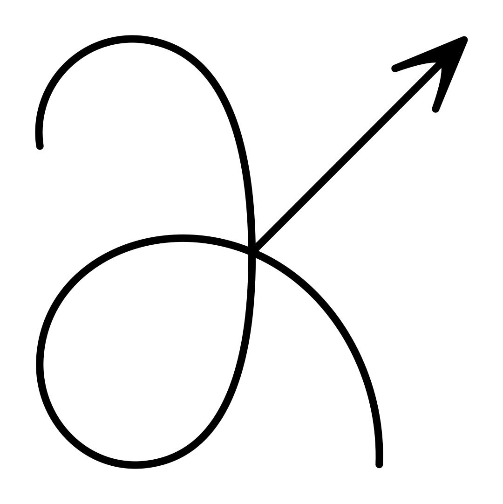
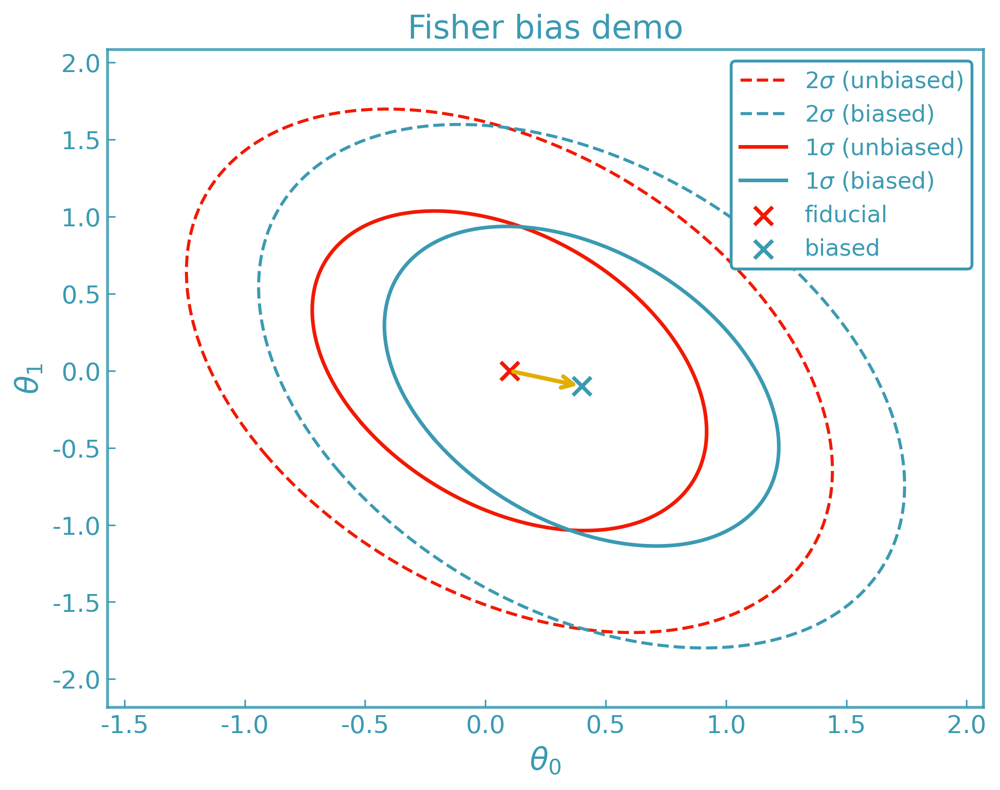
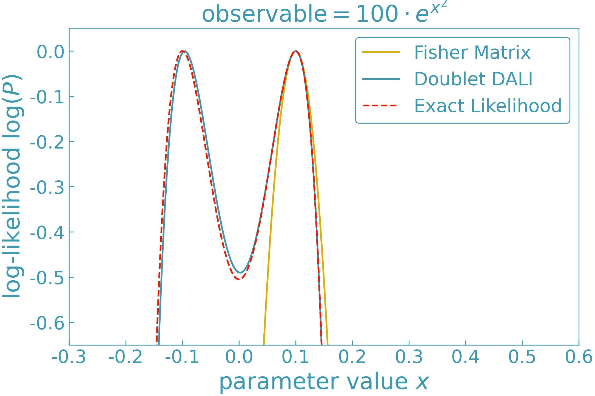
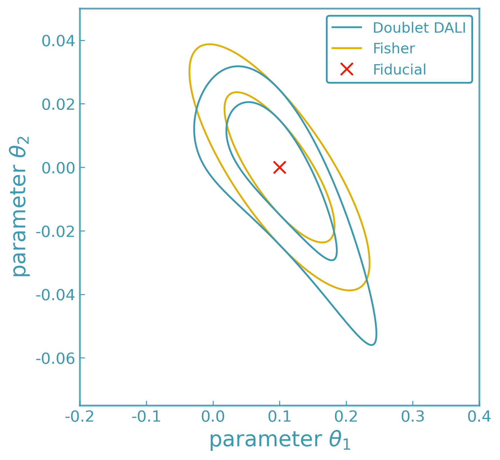

|dklogo| ForecastKit
====================

ForecastKit provides derivative-based tools for local likelihood and posterior
analysis. It uses numerical derivatives to construct controlled approximations
to a model’s likelihood or posterior around a chosen expansion point.

The toolkit includes multiple Fisher-matrix formalisms, Fisher bias,
Laplace approximations, and higher-order DALI expansions. It also provides
utilities for contour visualization and posterior sampling based on these
local approximations.

All methods rely on DerivativeKit for numerical differentiation and work with
arbitrary user-defined models.

Runnable examples illustrating these methods are collected in
:doc:`../../examples/index`.

Fisher Information Matrix
-------------------------

The Fisher matrix [#fisher]_ quantifies how precisely model parameters can be determined
from a set of observables under a local Gaussian approximation.

Given:

- parameters :math:`\theta = (\theta_1, \theta_2, \ldots)`
- a model mapping parameters to observables :math:`\nu(\theta)`
- a data covariance matrix :math:`C`

ForecastKit computes the Jacobian

.. math::

   J_{i a} = \frac{\partial \nu_i}{\partial \theta_a},

using DerivativeKit and CalculusKit, and constructs the standard Fisher matrix

.. math::

   F = J^\top C^{-1} J.

The Fisher matrix can be inverted to yield the Cramér–Rao lower bound [#crlb]_
on the parameter covariance matrix under the assumption that the likelihood is
locally Gaussian near its maximum. In this approximation, the inverse Fisher
matrix provides a lower bound on the achievable variances of unbiased
parameter estimators, independent of the specific inference algorithm used.
As a result, Fisher matrix methods offer a fast and computationally efficient
way to forecast expected parameter constraints without performing full
likelihood sampling.

Interpretation
^^^^^^^^^^^^^^

The Fisher matrix provides a fast, local forecast of expected parameter constraints
under a Gaussian likelihood approximation.

Examples
^^^^^^^^

The following examples illustrate typical Fisher-forecast workflows:

- A basic Fisher matrix computation:
  :doc:`../../examples/forecasting/fisher`

- Visualization of Fisher constraints using ``GetDist``:
  :doc:`../../examples/forecasting/fisher`

Generalized Gaussian Fisher
---------------------------

When the data covariance depends on the model parameters, the standard Fisher
matrix must be generalized to include derivatives of both the mean and the
covariance [#gaussfisher]_.

For a Gaussian likelihood with mean
:math:`\mu(\theta) = \langle d \rangle`
and covariance
:math:`C(\theta) = \langle (d - \mu)(d - \mu)^{\mathrm T} \rangle`,
the Fisher matrix is

.. math::

   F_{\alpha\beta}
   =
   \frac{1}{2}
   \mathrm{Tr}
   \!\left[
     C^{-1} C_{,\alpha} C^{-1} C_{,\beta}
   \right]
   +
   \mu_{,\alpha}^{\mathrm T}
   C^{-1}
   \mu_{,\beta}.

Here :math:`C_{,\alpha} \equiv \partial C / \partial \theta_\alpha` and
:math:`\mu_{,\alpha} \equiv \partial \mu / \partial \theta_\alpha`.

This expression reduces to the standard Fisher matrix when the covariance
is independent of the parameters.

Interpretation
^^^^^^^^^^^^^^

The generalized Gaussian Fisher provides a consistent local approximation
when both the signal and noise depend on the model parameters.

Examples
^^^^^^^^

A worked example is provided in :doc:`../../examples/forecasting/fisher_gauss`.

X–Y Fisher Formalism
--------------------

The X–Y Fisher formalism [#xyfisher]_ applies when the observables are naturally split into
measured inputs :math:`X` and outputs :math:`Y`, both of which are noisy and
possibly correlated.

The joint data covariance is written in block form as

.. math::

   C =
   \begin{pmatrix}
     C_{XX} & C_{XY} \\
     C_{XY}^{\mathrm T} & C_{YY}
   \end{pmatrix},

and the model predicts the expectation value of the outputs as
:math:`\mu(X, \theta)`.

Assuming the model can be linearized in the latent true inputs :math:`x`,

.. math::

   \mu(x) \simeq \mu(X) + T(X)\,(x - X),
   \qquad
   T_{ij} \equiv
   \frac{\partial \mu_i}{\partial x_j}\Big|_{x=X},

the latent variables can be marginalized analytically.

The resulting likelihood for :math:`Y` is Gaussian with an effective covariance

.. math::

   R
   =
   C_{YY}
   -
   C_{XY}^{\mathrm T} T^{\mathrm T}
   -
   T C_{XY}
   +
   T C_{XX} T^{\mathrm T}.

The Fisher matrix then takes the same form as the generalized Gaussian Fisher,
with the replacement :math:`C \rightarrow R`:

.. math::

   F_{\alpha\beta}
   =
   \frac{1}{2}
   \mathrm{Tr}
   \!\left[
     R^{-1} R_{,\alpha} R^{-1} R_{,\beta}
   \right]
   +
   \mu_{,\alpha}^{\mathrm T}
   R^{-1}
   \mu_{,\beta}.

Interpretation
^^^^^^^^^^^^^^

The X–Y Fisher matrix consistently propagates uncertainty in the measured
inputs into the output covariance, enabling Fisher forecasts when both inputs
and outputs are noisy.

Examples
^^^^^^^^

A worked example is provided in :doc:`../../examples/forecasting/fisher_xy`.

.. _forecastkit-fisher-bias:

Fisher Bias
-----------

Small systematic deviations in the observables can bias inferred parameters [#fisherbias]_.
These deviations are encoded as a difference data vector

.. math::

   \Delta \nu_i = \nu^{\mathrm{biased}}_i - \nu^{\mathrm{unbiased}}_i.

ForecastKit computes the first-order Fisher bias vector

.. math::

   b_a = \sum_{i,j} J_{i a}\, C^{-1}_{i j}\, \Delta \nu_j,

and the resulting parameter shift

.. math::

   \Delta \theta_a = \sum_b (F^{-1})_{a b}\, b_b.

ForecastKit returns:

- the bias vector
- the induced parameter shift
- optional visualization of the bias relative to Fisher contours

Interpretation
^^^^^^^^^^^^^^

Fisher bias characterizes the impact of model incompleteness rather than explicit
parameter perturbations. The difference vector :math:`\Delta\nu` represents a
systematic mismatch between the true data-generating model and the model assumed
in analysis, evaluated at the same fiducial parameters. The resulting shift
:math:`\Delta\theta` estimates how the inferred best-fit parameters would
move in order to absorb this mismatch if the systematic were neglected.
Fisher bias should therefore be interpreted as a diagnostic of whether a
given systematic can be safely ignored within a local Gaussian approximation.

In practice, the two data vectors entering :math:`\Delta\nu` are obtained
by evaluating two models at the same fiducial parameters: a baseline model used
for inference and a more complete model that includes additional physical or
instrumental systematics. Fisher bias then estimates how the inferred parameters
would shift if data generated by the more complete model were analyzed using the
baseline model alone. In this sense, Fisher bias quantifies the parameter impact
of neglecting specific systematic effects, rather than correcting for them.

The difference vector :math:`\Delta\nu_i` can be defined with either sign convention, *e.g.*
:math:`\pm\Delta\nu_i = \nu_i^{\mathrm{biased}} - \nu_i^{\mathrm{unbiased}}`.
The chosen convention fixes the interpretation of the resulting
parameter shift :math:`\Delta\theta`: changing the sign of :math:`\Delta\nu`
simply reverses the direction of the inferred bias and must be interpreted
accordingly.

Examples
^^^^^^^^

A worked example is provided in :doc:`../../examples/forecasting/fisher_bias`.

Laplace Approximation
---------------------

The Laplace approximation [#laplace]_ replaces the posterior distribution near its maximum
by a multivariate Gaussian obtained from a second-order Taylor expansion of the
negative log-posterior.

Let the log-posterior be

.. math::

   \mathcal{L}(\theta)
   =
   -\ln p(\theta \mid d)
   =
   -\ln \mathcal{L}(d \mid \theta)
   -\ln p(\theta).

Expanding around the maximum a posteriori (MAP) point
:math:`\hat{\theta}`, where
:math:`\nabla \mathcal{L}(\hat{\theta}) = 0`, gives

.. math::

   \mathcal{L}(\theta)
   \simeq
   \mathcal{L}(\hat{\theta})
   +
   \frac{1}{2}
   (\theta - \hat{\theta})^{\mathrm T}
   H
   (\theta - \hat{\theta}),

where the Hessian matrix is

.. math::

   H_{ab}
   \equiv
   \left.
   \frac{\partial^2 \mathcal{L}}{\partial \theta_a \partial \theta_b}
   \right|_{\theta = \hat{\theta}}.

Under this approximation, the posterior is Gaussian,

.. math::

   p(\theta \mid d)
   \approx
   \mathcal{N}
   \!\left(
     \hat{\theta},
     \, H^{-1}
   \right),

with covariance given by the inverse Hessian of the negative log-posterior.

In the special case of a flat prior and a Gaussian likelihood, the Hessian
reduces to the Fisher information matrix, and the Laplace approximation
coincides with the Fisher forecast.

Examples
^^^^^^^^

The following examples illustrate the Laplace approximation workflow:

- A basic Laplace approximation of the posterior:
  :doc:`../../examples/forecasting/laplace_approx`

- Visualization of Laplace-approximated posteriors using ``GetDist``:
  :doc:`../../examples/forecasting/laplace_contours`

DALI (Higher-Order Forecasting)
-------------------------------

The DALI expansion (Derivative Approximation for LIkelihoods; [#dali]_) extends
Fisher and Laplace approximations by retaining higher-order derivatives of the
likelihood around a chosen expansion point.

For a Gaussian likelihood with parameter-independent covariance, DALI
expands the model predictions around the fiducial parameters
:math:`\theta_0`. Defining the displacement
:math:`\delta = \theta - \theta_0`, the expected-data log-likelihood
can be approximated using contractions of model derivatives.

.. math::

   \log p(\theta \mid d)
   \simeq
   \log p(\theta_0 \mid d)
   - \frac{1}{2}
     F_{ab}\delta^a\delta^b
   - \frac{1}{2}
     D^{(1)}_{abc}\delta^a\delta^b\delta^c
   - \frac{1}{8}
     D^{(2)}_{abcd}\delta^a\delta^b\delta^c\delta^d
   + \cdots,

where the expression assumes expected data at the fiducial model
and a locally flat prior. A nonzero systematic mismatch introduces
additional bias terms, described in the DALI Bias section below.

The tensors are constructed from derivatives of the model
predictions evaluated at :math:`\theta_0`:

.. math::

   F_{ab}
   = \nu_{,a}^{\mathrm T}C^{-1}\nu_{,b},

.. math::

   D^{(1)}_{abc}
   = \nu_{,ab}^{\mathrm T}C^{-1}\nu_{,c},

.. math::

   D^{(2)}_{abcd}
   = \nu_{,ab}^{\mathrm T}C^{-1}\nu_{,cd}.

At second order ("doublet DALI"), the posterior takes the form

.. math::

   p(\theta \mid d)
   \propto
   \exp\!\left[
     -\frac{1}{2}F_{ab}\delta^a\delta^b
     -\frac{1}{2}D^{(1)}_{abc}\delta^a\delta^b\delta^c
     -\frac{1}{8}D^{(2)}_{abcd}\delta^a\delta^b\delta^c\delta^d
   \right].

Including third-order ("triplet DALI") terms introduces additional
correction tensors :math:`T^{(i)}`, constructed from third
derivatives of the model predictions, which capture higher-order
non-Gaussian structure.

Keep in mind that:

- DALI is a *local* approximation around ``theta0`` and may degrade far from the
  expansion point.
- DALI may perform poorly for models with weak or sublinear parameter dependence,
  or when increasing the expansion order does not improve convergence
  (see discussion in e.g. [#dali]_ and section VI.B of
  `arXiv:2211.06534 <https://arxiv.org/abs/2211.06534>`_).
- If DALI does not stabilize as the expansion order is increased,
  numerical posterior sampling (e.g. ``emcee``) should be used to validate
  the approximation.

Interpretation
^^^^^^^^^^^^^^

DALI provides a controlled hierarchy of local posterior approximations,
reducing to the Fisher and Laplace limits when higher-order derivatives vanish.

Examples
^^^^^^^^

The following examples illustrate the DALI approximation workflow:

- A basic DALI expansion of the posterior and visualization of DALI-expanded posteriors using ``GetDist``:
  :doc:`../../examples/forecasting/dali`

DALI Bias
---------

The DALI bias formalism [#dalibias]_ extends Fisher bias forecasting
beyond the local Gaussian approximation. It uses higher-order model
derivatives to predict how systematic data mismatches shift the
posterior maximum and mean.

For a model prediction :math:`\nu(\theta)` and a fixed data covariance
:math:`C`, the systematic mismatch is defined as

.. math::

   \Delta\nu = \langle d\rangle - \nu(\theta_0),

where :math:`\theta_0` is the fiducial parameter point and
:math:`\langle d\rangle` is the expected data vector.

The standard Fisher bias uses only first derivatives of the model.
DALI bias additionally includes higher-order derivatives, allowing
the parameter response to depend nonlinearly on the mismatch.

Higher-Order Bias Tensors
^^^^^^^^^^^^^^^^^^^^^^^^^

The systematic mismatch enters the DALI expansion through the
bias tensors

.. math::

   b_{a_1\ldots a_n}
   =
   \Delta\nu^{\mathrm T}
   C^{-1}
   \nu_{,a_1\ldots a_n},

where :math:`\nu_{,a_1\ldots a_n}` denotes the corresponding
model derivative evaluated at :math:`\theta_0`.

The first-order tensor recovers the usual Fisher bias vector.
The second- and third-order tensors describe how the systematic
mismatch couples to nonlinear model derivatives.

Writing :math:`\delta=\theta-\theta_0`, the mismatch-dependent
contribution to the DALI log-likelihood is

.. math::

   B(\delta)
   =
   b_a\delta^a
   + \frac{1}{2}b_{ab}\delta^a\delta^b
   + \frac{1}{3!}b_{abc}\delta^a\delta^b\delta^c.

These terms modify the posterior beyond a simple translation
of its maximum.

Maximum a Posteriori Shift
^^^^^^^^^^^^^^^^^^^^^^^^^^

The maximum a posteriori (MAP) estimate is obtained by setting
the gradient of the biased log-posterior to zero:

.. math::

   \left.
   \frac{\partial\log p(\theta\mid d)}
        {\partial\theta_a}
   \right|_{\theta=\hat{\theta}}
   =0.

The resulting parameter displacement can be expanded in powers
of the systematic mismatch:

.. math::

   \Delta\hat{\theta}^a
   =
   \Delta\theta_{\mathrm G}^a
   + \sum_{n=2}^{\infty}
     \delta_{\mathrm{NG},n}^a,

where the Gaussian contribution is

.. math::

   \Delta\theta_{\mathrm G}
   =
   (F-B_2)^{-1}b,

with :math:`(B_2)_{ab}=b_{ab}`.

At leading order, this reduces to the standard Fisher bias:

.. math::

   \Delta\theta_{\mathrm F}^a
   =
   (F^{-1})^{ab}b_b.

The non-Gaussian corrections involve contractions of the
higher-order DALI and bias tensors. They account for the
nonlinear response of the posterior maximum as the mismatch
moves the inferred parameters away from the fiducial point.

Posterior Mean Shift
^^^^^^^^^^^^^^^^^^^^

For a non-Gaussian posterior, the MAP and posterior mean do not
generally coincide. The posterior mean is defined by

.. math::

   \bar{\theta}^a
   =
   \int \theta^a p(\theta\mid d)
   \,\mathrm{d}^{N_{\mathrm{par}}}\theta.

DALI bias therefore distinguishes between shifts of the
posterior maximum and shifts of the posterior mean.

The analytic mean approximation expresses the mean as a
correction to the MAP:

.. math::

   \bar{\theta}^a
   =
   \hat{\theta}^a
   - \frac{1}{2}
     C^3_{ijk}(C^2)^{ia}(C^2)^{jk}
   - \frac{1}{8}
     C^5_{ijklm}(C^2)^{ia}
     (C^2)^{jk}(C^2)^{lm}.

Here :math:`C^n` are the derivatives of the negative
log-posterior evaluated at the biased MAP, and
:math:`(C^2)^{ij}` denotes the inverse of its quadratic
coefficient matrix.

This approximation captures the leading mean--MAP offset
arising from the non-Gaussian posterior structure.

Posterior Mean Response
^^^^^^^^^^^^^^^^^^^^^^^

An alternative approach expands the posterior mean directly
in the amplitude of the systematic mismatch while retaining
the complete unbiased DALI posterior as the reference
distribution.

For a mismatch :math:`\Delta\nu=A s`, define the
mismatch-induced log-likelihood contribution

.. math::

   B(\theta;A)=A\,U(\theta),

where :math:`U` is constructed from the bias tensors
associated with the systematic template :math:`s`.

The systematic posterior mean response is

.. math::

   \Delta\bar{\theta}^a(A)
   =
   \bar{\theta}^a(A)-\bar{\theta}^a(0)
   =
   \sum_{n=1}^{\infty}
   \frac{A^n}{n!}
   \kappa_0(\theta^a,U,\ldots,U),

where :math:`\kappa_0` denotes a joint cumulant evaluated
under the unbiased DALI posterior, with :math:`n` copies
of :math:`U`.

At first order,

.. math::

   \Delta\bar{\theta}^a(A)
   =
   A\,\operatorname{Cov}_0(\theta^a,U)
   + O(A^2).

Thus, the initial response of the posterior mean is
determined by the covariance between the parameter and
the systematic perturbation under the unbiased posterior.

Unlike the local analytic mean approximation, this method
retains the complete non-Gaussian structure of the reference
DALI posterior.

Interpretation
^^^^^^^^^^^^^^

DALI bias predicts how an unmodelled systematic changes
parameter inference beyond the linear Fisher approximation.

Three distinctions are important:

- The MAP shift describes the movement of the posterior maximum,
  while the mean shift describes the movement of its probability
  weighted average.
- The systematic mean shift must be measured relative to the
  unbiased posterior mean, which need not coincide with the
  fiducial parameter point.
- The response depends on both the magnitude and direction
  of the mismatch in data space.

For multiple additive systematic mismatches, the parameter
response need not be additive. Defining the systematic shift
of an estimator by :math:`\Delta\theta`, the nonadditive
contribution is

.. math::

   \Delta\theta_{\mathrm{nonadd}}
   =
   \Delta\theta_{\alpha+\beta}
   - \Delta\theta_\alpha
   - \Delta\theta_\beta.

This quantity vanishes for the linear Fisher response but
can be nonzero when higher-order corrections become important.

DALI bias remains a local derivative-based approximation.
Its accuracy depends on the quality of the DALI expansion,
the convergence of the systematic response, and the
posterior region explored by the mismatch. Numerical
validation is recommended when the predicted shifts become
large or higher-order corrections fail to stabilize.

Examples
^^^^^^^^

A worked example demonstrating DALI systematic bias tensors,
MAP shifts, posterior mean shifts, and numerical validation
is provided in :doc:`../../examples/forecasting/dali_bias`.

Priors
------

ForecastKit methods can be used either as *likelihood* approximations or as
*posterior* approximations. The distinction is whether a prior contribution is
included.

Given data :math:`d`, the posterior is

.. math::

   \log p(\theta \mid d)
   =
   \log p(d \mid \theta)
   +
   \log p(\theta)
   + \mathrm{const}.

ForecastKit represents priors as callables that evaluate a log-density
(up to an additive constant). Hard exclusions are encoded by returning
``-np.inf``, corresponding to zero probability outside the allowed region
of parameter space.

Where Priors Enter
^^^^^^^^^^^^^^^^^^

Priors affect different forecasting methods in distinct ways:

- **Fisher and generalized Fisher**

  Fisher forecasts are Gaussian *likelihood* approximations by default.
  A Gaussian prior may be incorporated analytically by adding its precision
  matrix to the Fisher matrix.

  For a Gaussian prior with covariance :math:`C_{\mathrm{prior}}`,

  .. math::

     F_{\mathrm{post}}
     =
     F_{\mathrm{like}} + C_{\mathrm{prior}}^{-1}.

  This yields a Gaussian approximation to the *posterior* and preserves the
  Fisher formalism.

- **Laplace and DALI approximations**

  Laplace and DALI operate directly on the log-posterior when a prior is
  supplied. In this case, the prior contribution is evaluated explicitly
  alongside the likelihood expansion, and hard bounds may exclude regions
  of parameter space.

- **Sampling and visualization**

  Plotting tools such as ``GetDist`` do not apply priors implicitly. If samples
  are drawn from a Fisher, Laplace, or DALI approximation without including
  a prior term, the resulting contours correspond to the likelihood
  approximation alone.

  To visualize posterior constraints, the prior must be included explicitly
  when generating samples.

Prior Construction
^^^^^^^^^^^^^^^^^^

ForecastKit provides a unified prior interface via
:func:`derivkit.forecasting.priors_core.build_prior`.

A prior is constructed by combining one or more *prior terms*, each of which
defines a log-density contribution, and optional hard bounds. The resulting
callable evaluates

.. math::

   \log p(\theta) = \sum_k \log p_k(\theta),

returning ``-np.inf`` if any term or bound is violated.

Supported prior terms include:

- uniform (hard bounds)
- multivariate Gaussian and diagonal Gaussian
- log-uniform / Jeffreys
- half-normal and half-Cauchy
- log-normal
- Beta distributions
- Gaussian mixture priors

Interpretation
^^^^^^^^^^^^^^

Priors control identifiability and regularization in local forecasts. They can:

- stabilize ill-conditioned Fisher matrices,
- enforce physical parameter support (e.g. positivity),
- encode external information or weakly informative assumptions,
- determine whether a local approximation should be interpreted as a
  likelihood forecast or a posterior forecast.

Care should be taken to distinguish numerical regularization from genuine
prior information when interpreting forecasted parameter constraints.

Examples
^^^^^^^^

Practical examples demonstrating how priors are incorporated are provided in:

- :ref:`Including priors in Fisher contours <fisher-including-priors>`
  for Fisher forecasts
- :ref:`Including priors in DALI contours <dali-including-priors>`
  for DALI-based posterior sampling

Posterior Sampling and Visualization
------------------------------------

ForecastKit provides utilities to draw samples directly from Fisher, Laplace,
or DALI-expanded posteriors and to convert them into GetDist-compatible [#getdist]_
``MCSamples`` objects.

This enables:

- posterior sampling based on local likelihood approximations using emcee [#emcee]_
- easy integration with GetDist for contour plotting and statistical summaries
- direct contour visualization and uncertainty propagation
- comparison between Fisher, Laplace, and DALI forecasts

These workflows are designed for forecasting and local posterior analysis,
providing fast and controlled approximations to parameter constraints without
requiring full likelihood evaluations with MCMC or nested sampling methods.

Examples:
^^^^^^^^^
Worked examples are provided in:
- :doc:`../../examples/forecasting/fisher` for Fisher-based GetDist samples
- :doc:`../../examples/forecasting/dali` for DALI-based posterior sampling
- :doc:`../../examples/forecasting/laplace_contours` for Laplace approximations

Backend Notes
-------------

- If ``method`` is omitted, the local polynomial derivative backend is used.
- Any DerivativeKit backend may be selected
  (finite differences, Ridders, Gauss–Richardson, polynomial fits, etc.).
- Changing the derivative backend affects only how derivatives are computed,
  not the forecasting logic itself.

``ForecastKit`` is fully modular and designed to scale from simple Gaussian
forecasts to higher-order likelihood expansions with minimal code changes.

References
----------

.. [#fisher] Wikipedia, *Fisher information matrix*,
   https://en.wikipedia.org/wiki/Fisher_information
.. [#crlb] Wikipedia, *Cramér–Rao bound*,
   https://en.wikipedia.org/wiki/Cramér–Rao_bound
.. [#gaussfisher] M. Tegmark et al., *Karhunen-Loeve eigenvalue problems in cosmology: how should we tackle large data sets?*,
   https://arxiv.org/abs/1404.2854
.. [#xyfisher] A. Heavens et al., *Generalised Fisher Matrices*,
   https://arxiv.org/abs/1404.2854
.. [#dali] E. Sellentin et al., *Breaking the spell of Gaussianity: forecasting with higher order Fisher matrices*
   https://arxiv.org/abs/1401.6892
.. [#getdist] A. Lewis, *GetDist: a Python package for analysing Monte Carlo samples*,
   https://arxiv.org/abs/1910.13970
.. [#emcee] D. Foreman-Mackey et al., *emcee: The MCMC Hammer*,
   https://arxiv.org/abs/1202.3665
.. [#laplace] Wikipedia, *Laplace's approximation*,
   https://en.wikipedia.org/wiki/Laplace%27s_approximation
.. [#fisherbias] A. Amara and A. Réfrégier, *Systematic Bias in Cosmic Shear: Beyond the Fisher Matrix*,
   https://arxiv.org/abs/0710.5171
.. [#dalibias] N. Šarčević, M. van der Wild, and E. Sellentin,
   *Non-Gaussian Parameter Bias: Formalism and Validation*,
   https://arxiv.org/abs/2610.02104
